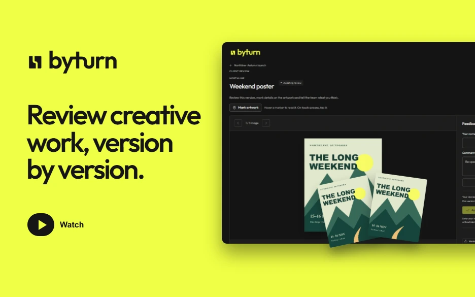
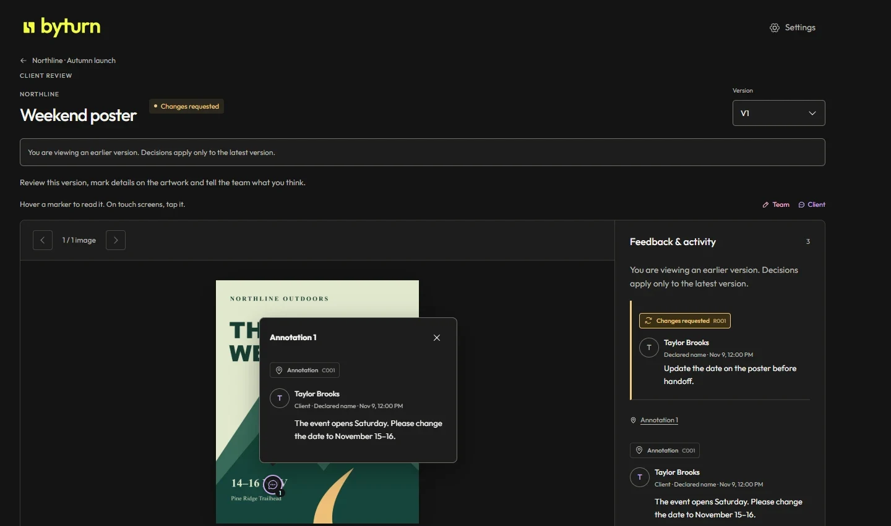
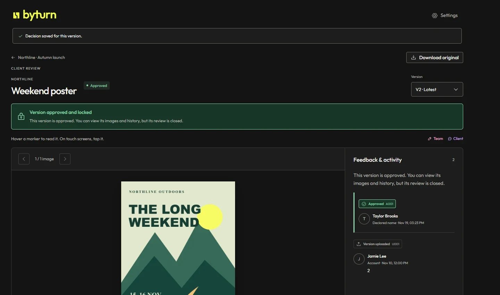
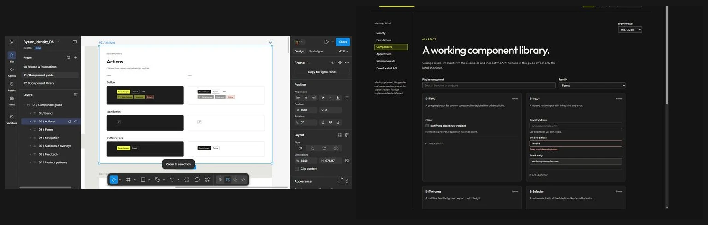

# Byturn

**Creative review and approvals, version by version.**

Byturn gives studios a self-hosted workspace to share artwork, collect feedback directly on images, and hand off the approved files. Clients can open a revocable review link and leave feedback without creating an account.

[Open the interactive demo](https://viihgod.github.io/byturn/) · [Watch the walkthrough](https://viihgod.github.io/byturn/showcase/) · [Run Byturn locally](#run-byturn-locally) · [Download the preview release](https://github.com/Viihgod/byturn/releases/tag/v0.1.0)

[](https://viihgod.github.io/byturn/showcase/)

## From first draft to approved artwork

1. **Share a version.** Upload original images, arrange them as a carousel, and send the client a review link.
2. **Review in context.** Pin a comment to the artwork or request changes for that version. A revised upload starts a new review and keeps earlier feedback available.
3. **Approve and deliver.** Approval closes the review for that version. The client can revisit its history and download the originals.





The [interactive demo](https://viihgod.github.io/byturn/) opens a fictional client project. Switch to **V1** to inspect the feedback, return to **V2** to approve it, and download the revised poster. Reload or use **Reset demo** to start over.

## Design and implementation

Byturn pairs a Figma component library with React components and shared design tokens. The local component guide at `/?guide=1` shows component states in light and dark themes. The interface is available in English and Brazilian Portuguese.



The self-hosted preview uses React, TypeScript, Node.js 24, SQLite, and private file storage. It supports internal accounts, explicit project access, optional client accounts, and revocable review links. See the [access rules](docs/product-access.md) for how permissions and review decisions work.

## Run Byturn locally

With Node.js 24 installed, run:

```sh
npm ci
npm run setup:demo
npm run build
npm start
```

Open <http://127.0.0.1:4174>. The demo setup requires an empty user database. The [runbook](docs/product-runbook.md) covers local demo accounts, administrator setup, configuration, and backups.

## Develop and verify

- `npm run check` runs lint, UI and tooling tests, server integration tests, the type check, and the production build.
- `npm run test:server` exercises the server with temporary databases and files.
- `npm run package:design` and `npm run review:build` produce the design package and standalone component guide.

The source is organized into [product UI](src/product), [server](server), [design system](src/design-system), and [component guide](src/catalog). See the [product review notes](docs/product-review.md) and [delivery decisions](docs/decisions/003-delivery.md) for more detail.

## License

The code is licensed under [Apache 2.0](LICENSE). See [NOTICE](NOTICE) for third-party licenses and brand terms.